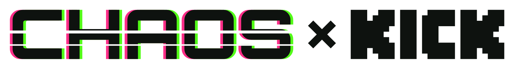
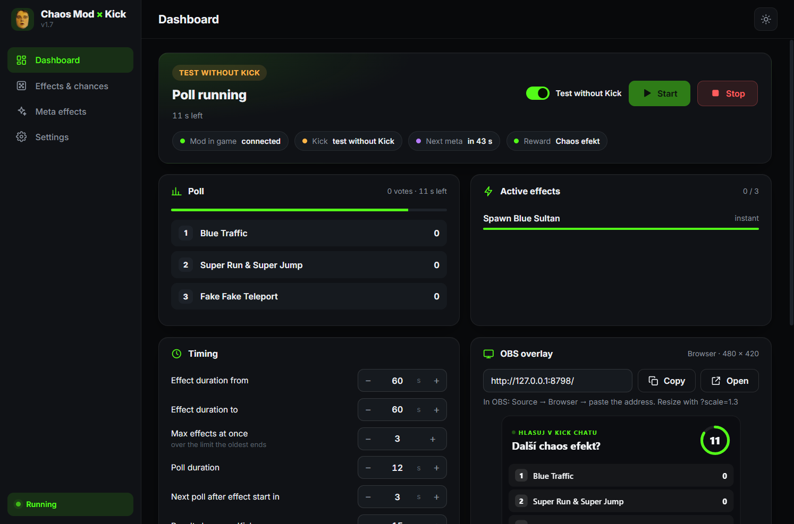

<picture>
  <source media="(prefers-color-scheme: dark)" srcset="assets/logo-dark.png">
  
</picture>

# Chaos Mod × Kick

**Let your Kick chat control the chaos in GTA V: polls pick the next Chaos Mod effect, viewers trigger effects with channel points.**

 

 

## What it does

- **Kick polls run the show.** The app picks a few random effects, starts a native `/poll` in your Kick chat and fires the winner in GTA V – round after round, fully automatic.
- **Channel points reward.** Viewers redeem a reward, type an effect name (English or Czech, typos are fine) and it starts right away. Optional cooldown pauses the reward on Kick for a while.
- **Meta effects** every few minutes: double or half effect duration, faster or slower polls, Combo Time, Minority Voting, No Chaos, Re-Invoke and more – all applied to what chat votes in.
- **Effects & chances.** All 358 effects sorted into categories – turn any off or make it rare / often / very often.
- **Timing your way.** Effect duration as a from–to range, poll length, delay between effects, how many effects can run at once.
- **OBS overlay** with the live poll, countdown and reward redemptions – plus a live preview inside the app.
- **Dark / light theme, English / Czech**, and automatic updates.

## Requirements

- **GTA V for PC**, story mode only (never use mods in GTA Online).
- **[Script Hook V](http://www.dev-c.com/gtav/scripthookv/)** with its ASI loader (`ScriptHookV.dll` and `dinput8.dll` in the game folder).
- **[Chaos Mod V](https://github.com/gta-chaos-mod/ChaosModV/releases)** (`ChaosMod.asi` and the `chaosmod` folder in the game folder).
- A **Kick account** that owns or moderates the channel.

## Install

1. Download `Chaos-on-Kick.exe` from the [latest release](https://github.com/TwinderR/chaos-on-kick/releases/latest) and put it anywhere you like.
2. Run it. Windows may show a blue *"Windows protected your PC"* screen, because the app is not signed yet. Choose **More info**, then **Run anyway**.
3. In **Settings**:
   - type your **Kick channel**,
   - paste your **session token** – the whole *Copy as cURL* text is fine, the app picks out the token (the step-by-step guide is right next to the field),
   - check the **GTA V folder** (found automatically when the game is running).
4. Start GTA V, load story mode and press **Start** on the Dashboard.
5. The first time (or after changing durations / limits) press **Ctrl+L twice** in game so Chaos Mod reloads its settings. The Dashboard tells you when this is needed.

**OBS:** add a *Browser* source with the address shown in the *OBS overlay* card (480 × 420, `?scale=1.3` to resize).

**Channel points:** create a reward on Kick with *Requires user input* turned on, use the same name in **Settings → Channel points reward** and switch it on.

## Updates

The app checks this page every 30 minutes. When a new version is out, a pop-up shows what changed and one click updates and restarts the app – your settings stay. You can also check any time in **Settings → Updates**. Every version and its changes are listed under [Releases](https://github.com/TwinderR/chaos-on-kick/releases).

## Good to know

- Settings, including the session token, are stored only on your computer in `%APPDATA%\chaos-on-kick`. The token is a login to your Kick account – never share it. Logging out of kick.com invalidates it.
- The app takes over Chaos Mod's timing: it turns off the mod's own timer and sets effect durations. To use Chaos Mod on its own again, delete `chaosmod\configs\config.json` and `chaosmod\configs\effects.json` in the game folder (or set them up again in the Chaos Mod configurator).
- To uninstall, delete `Chaos-on-Kick.exe` and the `%APPDATA%\chaos-on-kick` folder.
- Found a bug or have an idea? [Open an issue](https://github.com/TwinderR/chaos-on-kick/issues).

 

Chaos Mod × Kick is an independent project, not affiliated with or endorsed by Kick, Rockstar Games or the Chaos Mod V team.

